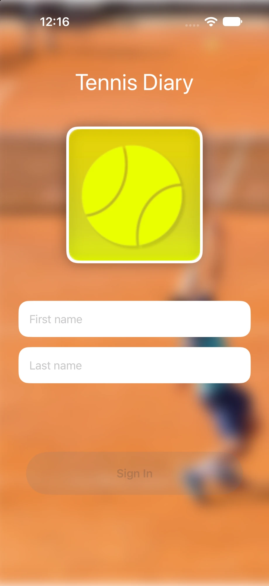
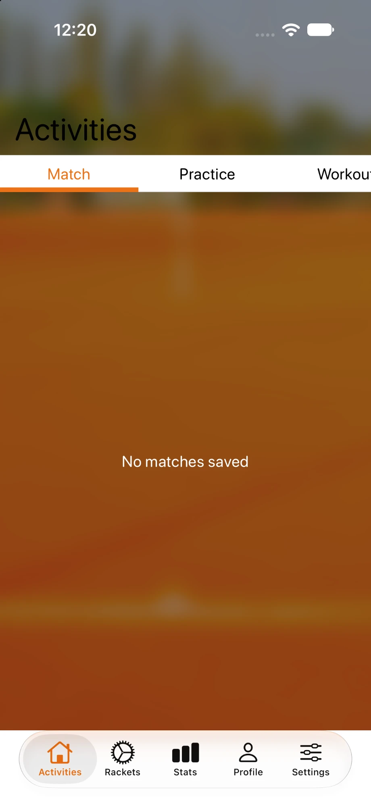
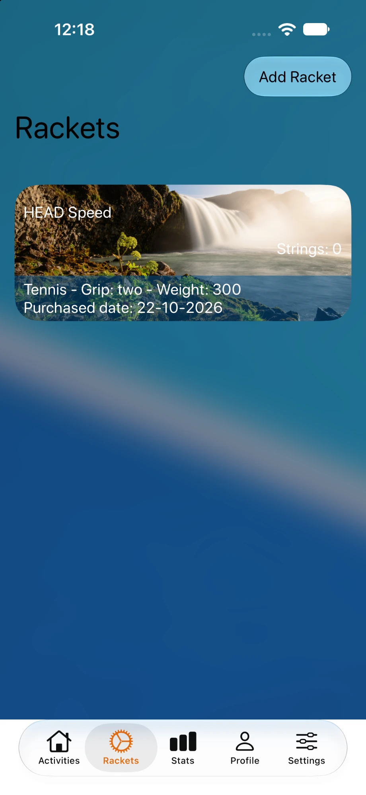
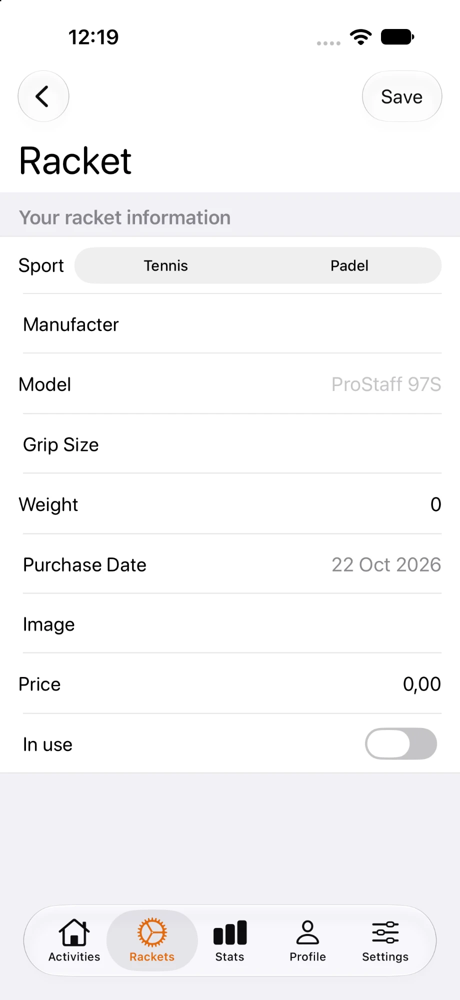
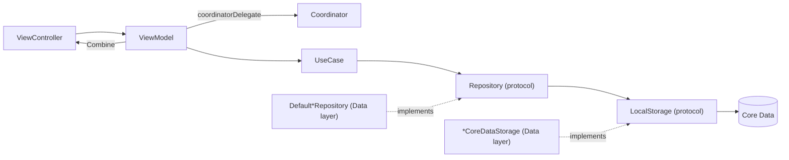

# Tennis app

> [!WARNING]
> **This project is archived and no longer maintained.**
>
> Started in 2016, TennisApp was a personal playground: over the years I used it to learn new things, try out architectural patterns (Clean Architecture, MVVM + Coordinators, DI containers) and experiment with frameworks and APIs (Combine, Core Data, SwiftUI inside UIKit, modern collection views). Expect unfinished features and work-in-progress code. This proof of concept hasn't been actively developed for many years and would now need to be rethought from a different perspective.

## 📸 Screenshots

| Login | Activities | Rackets | Racket form |
| :---: | :---: | :---: | :---: |
|  |  |  |  |

## 📱 TennisApp

To run the project, clone the repo, open with Xcode and run from `TennisApp` target. To run unit tests type `CMD + U`

`TennisApp/GoogleService-Info.plist` contains placeholder values: to use Firebase Authentication, replace it with the file downloaded from your own Firebase project.

## 📌 Requirements

+ Xcode 16+
+ Swift 5.9+
+ Deployment target iOS 18+

## ⚙️ Tools

+ **Swiftlint** to enhance code styling

You can install those tools from terminal:

```bash
brew update
brew install swiftlint
```

## 🏛️ Architecture

The app follows a **Clean Architecture** layout with **MVVM + Coordinators** in the presentation layer. UIKit is the main UI framework; some screens (Settings, SignUp, Stats) host **SwiftUI** views inside a UIKit view controller.

```
TennisApp/
├── Application      # Entry point, AppCoordinator, DI containers
├── Presentation     # Coordinators, ViewControllers, ViewModels, Design Library
├── Domain           # Models, UseCases, Repository protocols (no framework dependencies)
├── Data             # Repository implementations, Core Data / UserDefaults storage
├── Infrastructure   # Firebase service, Logger
└── Resources        # Localizable.xcstrings
```

### Dependency flow



Dependencies point inwards: `Domain` defines the protocols (`RacketsRepository`, `RacketsFetchUseCase`, …) and the `Data` layer implements them.

### Layers

+ **Application**
    + `SceneDelegate` creates the window and starts the `AppCoordinator` (UIScene life cycle).
    + `AppCoordinator` builds the `UITabBarController` with five tabs (Activities, Rackets, Stats, Profile, Settings) and handles the Login / SignUp flows.
    + `AppDIContainer` lazily owns one DI container per feature (`RacketsDIContainer`, `StringsDIContainer`, `ProfileDIContainer`, …). Each feature container exposes `make…UseCase()` factories and privately wires repositories and storages.
+ **Presentation**
    + **Coordinators** (`Coordinator`, `TabBarItemCoordinator`) own navigation: they instantiate view controllers, inject view models and push child coordinators (e.g. `RacketsCoordinator` → `StringsCoordinator`, `RacketFormCoordinator`). Child coordinators report back via delegate protocols (`…CoordinatorDidFinish`).
    + **ViewModels** receive use cases through their initializer, expose state to the view via **Combine** publishers (`PassthroughSubject` / `AnyPublisher`, see `BindableViewModelType`) and request navigation through a weak `coordinatorDelegate`.
    + **ViewControllers** are loaded from one storyboard each (`StoryboardInstantiable`). Lists use modern `UICollectionView` list layouts with custom content configurations (`*ContentView` + `*ListCell` + cell `*ViewModel`).
    + **Forms** are built with **Eureka** through `FormFactory` (`RacketForm`, `StringForm`, `MatchForm`).
    + **DesignLibrary** centralizes design tokens (colors, fonts, SF Symbols, misc assets) behind `DesignLibraryProvider`.
    + Shared behaviours are expressed as protocols: `Alertable`, `LoadingIndicator`, `BackgroundBlurrable`, `Bindable`.
+ **Domain**
    + Plain Swift models: `User`, `Racket`, `Strings`, `Match`, `MatchScore`, `Practice`, `Workout` and enums (`GripSize`, `RacketBrand`, `StringsBrand`, `Sport`).
    + One use case per operation (`RacketsFetchUseCase`, `RacketSaveUseCase`, `RacketDeleteUseCase`, …), each with a `Default…` implementation that delegates to a repository.
    + Repository protocols (`RacketsRepository`, `StringsRepository`, `UsersRepository`).
+ **Data**
    + `Default…Repository` implementations, backed by a `…LocalStorage` protocol.
    + `CoreDataStorage` wraps the `NSPersistentContainer` for the `AppCoreDataModel` model (entities: `UserEntity`, `RacketEntity`, `StringsEntity`, `MatchEntity`, `MatchScoreEntity`, `PracticeEntity`, `WorkoutEntity`).
    + `…CoreDataStorage` classes perform the fetch/save/delete requests; `LocalEntity` extensions map between Core Data entities and domain models (`toDomain()` / `init(racket:insertInto:)`).
    + `UserDefaultsStorage` for lightweight preferences.
+ **Infrastructure**
    + `FirebaseService` wraps Firebase Auth (sign in / sign up / sign out) behind `FirebaseServiceType`.
    + `Log` is a pluggable logger with console and null profiles.

### Data persistence status

Rackets, Strings and Users go through the full UseCase → Repository → Core Data pipeline. Activities (matches, practices, workouts) and Stats have domain models and Core Data entities, but no use cases or repositories yet. Data access is still callback-based (`Result` completion handlers); moving to async/await is tracked below.

### Third-party dependencies (Swift Package Manager)

| Package | Usage |
| --- | --- |
| [Firebase](https://github.com/firebase/firebase-ios-sdk) | Authentication |
| [Eureka](https://github.com/xmartlabs/Eureka) + [ImageRow](https://github.com/EurekaCommunity/ImageRow) | Racket / Strings / Match forms |
| [Parchment](https://github.com/rechsteiner/Parchment) | Paging menu in the Activities tab |
| [IQKeyboardManager](https://github.com/hackiftekhar/IQKeyboardManager) | Declared in the project but not currently imported in code |

Native Apple frameworks: UIKit, SwiftUI, Combine, Core Data, Swift Charts (Stats).

### Tests

`TennisAppTests` covers the Core Data storages (using `CoreDataStorageMock`, an in-memory store) and `NavigationControllerBuilder`.

## 🔨 TODO / Improvements

+ [] Add forms for activities
+ [] Complete SignUp page
+ [] Add DTO to decouple domain model from CoreDataStorage
+ [] Entity relationships
+ [] Add builder to convert form to Model (formValues -> ´Rackets´)
+ [] Convert repository with async/await
+ [] See https://github.com/AvdLee/StockAnalyzerApp for Terms and Privacy
+ [~] Use [Modern cell configuration](https://developer.apple.com/videos/play/wwdc2020/10027/)
+ [~] Create repositories
+ [~] Create UseCases
+ [~] CRUD operation for User, Match and others
+ [X] Settings View in **SwiftUI**
+ [X] SignUp view in **SwiftUI**
+ [X] Implementing Modern Collection Views (https://swiftsenpai.com/development/uicollectionview-list-basic/) instead of UITableView
+ [X] Add Design Library
+ [X] Refactor localization
+ [X] Add DI containers
+ [X] Create domain model
+ [X] Rename RealmStorage protocols
+ [X] Remove Realm and use CoreData
+ [X] Split Storyboard (use one storyboard for each controller)
+ [X] RacketFormViewModel refactor using Racket instead RacketEntity
+ [X] Remove FontAwesome
+ [X] Remove MBProgressHUD
+ [X] Use TabBarController instead of RESideMenu
+ [X] CRUD operation for Racket
+ [X] `FirebaseService` add `Result` type instead of completion block
+ [X] Use Combine instead of Bond
+ [X] Remove `SCLAlertView`

## 📰 Articles, resources

### UIKit equivalent in SwiftUI

+ https://fuckingswiftui.com/

### Combine + MVVC

+ https://betterprogramming.pub/uikit-mvvm-combine-912c80c02262
+ https://betterprogramming.pub/form-validation-in-uikit-made-easy-with-combine-dd8245bacb6c

### Architecture 

+ Clean architecture apps:
    + https://github.com/rcaos/TVToday
    + https://github.com/petros-efthymiou/Mobile-iOS-Microservices-Architecture
    + https://github.com/petros-efthymiou/iOS-Pragmatic-Clean-Architecture

## ✒️ Author

Andrea Stevanato
